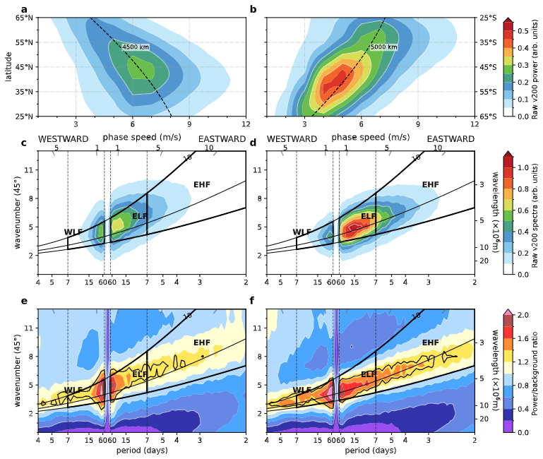
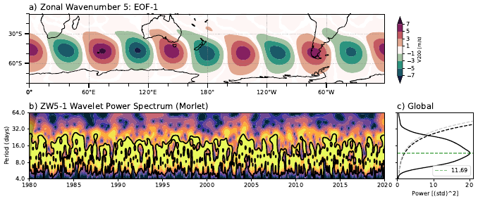
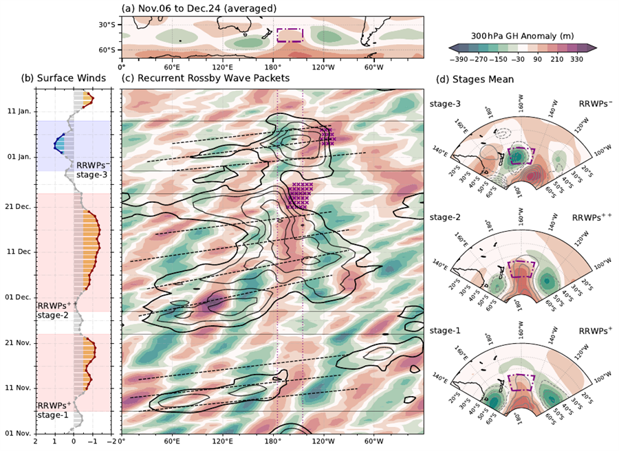
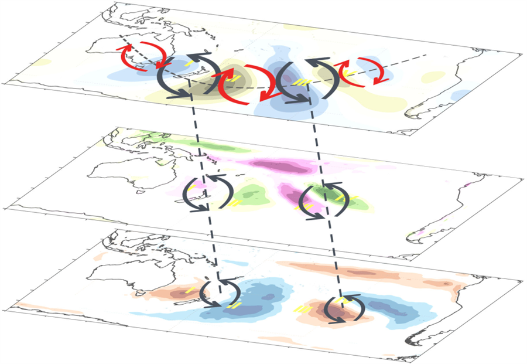
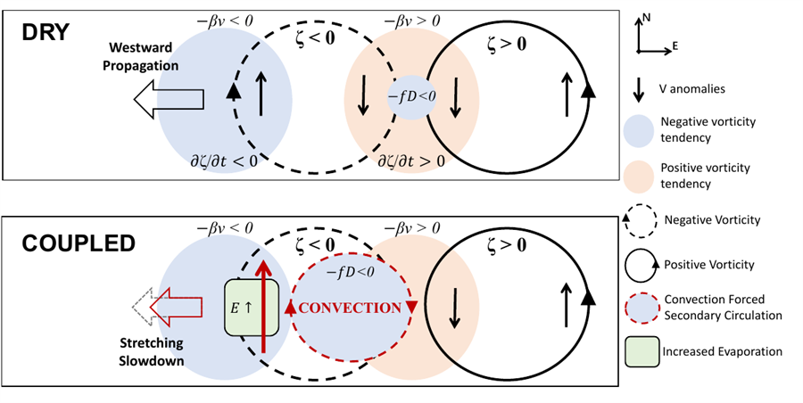
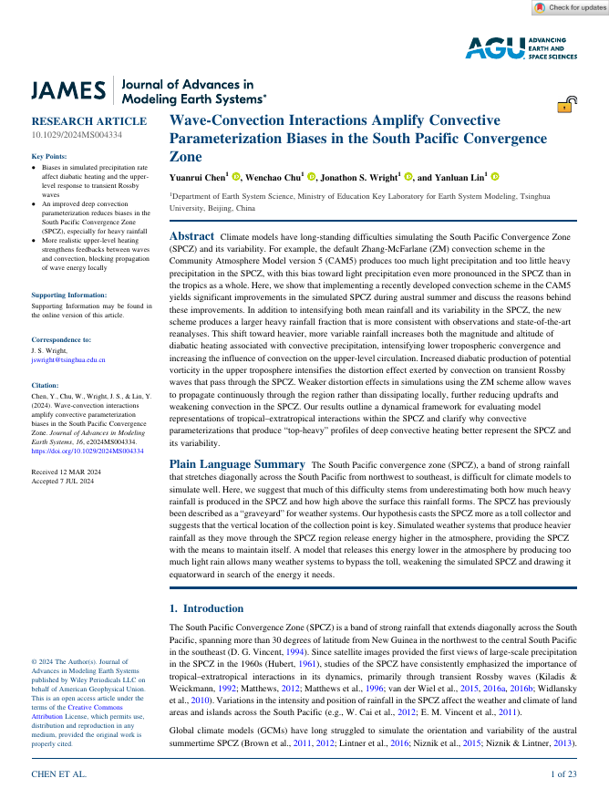

I am a Ph.D. candidate in Atmospheric Science at Tsinghua University, working with [Prof. Jonathon S. Wright](https://jonathonwright.github.io/). I study **how atmospheric waves organize weather and climate**. I am interested in how these waves grow and propagate, how they interact with convection and the surface, and how these interactions shape weather patterns and climate variability. Despite their importance for extreme weather, global rainfall patterns, and future climate projections, many aspects of these interactions remain poorly understood. Their highly nonlinear nature makes them difficult to unravel, and limitations in their representation contribute to persistent biases in numerical models. I combine **observations, dynamical theory, numerical modeling, and AI-based approaches** to investigate the physical mechanisms behind these interactions and their implications for weather and climate predictability.

Outside academia, I enjoy discovering good food, traveling, and spending quiet time reading or watching films.

<figure class="intro-photo"></figure>

# Publications

## Accepted

<figure class="paper-thumb"></figure>

### Mid-Latitude Wave Activity in Wavenumber-Frequency Space: Climatology, Trends, and CGT5-like Circulation Changes

**Yuanrui Chen**, Wenhao Dong, and Jonathon S. Wright  
Accepted for publication in *Climate Dynamics* 

- **Spectral view of circulation change.** Separates distinct midlatitude wave components and shows that recent circulation trends and CGT5-like changes emerge from their combined contributions rather than a single stationary pattern.

## Online

<h3 class="publication-theme"><em>“Waves are everywhere.”</em></h3>

<figure class="paper-thumb"></figure>

### [On the Dynamics and Impacts of the Summertime Southern Hemisphere Dominant Wave Mode](https://doi.org/10.1002/qj.5069)

**Yuanrui Chen**, Yanluan Lin, and Jonathon S. Wright  
*Quarterly Journal of the Royal Meteorological Society*

- **Wave life cycle and impacts.** Tracks the propagation and intensity of Southern Hemisphere zonal wavenumber 5, linking its growth and decay to surface weather and concurrent heat extremes.

<figure class="paper-thumb"></figure>

### [Recurrent Synoptic Waves Instigated Severe Marine Heatwave in the Southwest Pacific](https://doi.org/10.1029/2024JD043232)

**Yuanrui Chen**, Fanghua Xu, and Jonathon S. Wright  
*Journal of Geophysical Research: Atmospheres* [**(ICDM2024 Best Oral)**](https://jonathonwright.github.io/news/announcement_1/)

- **Extreme-event mechanism.** Shows how recurrent synoptic Rossby wave packets organized surface circulation and mixed-layer evolution during the severe 2019/2020 Southwest Pacific marine heatwave.

<figure class="paper-thumb"></figure>

  
### [A Coupled Quadrupole Mode in the South Pacific](https://doi.org/10.1175/JCLI-D-23-0638.1)

**Yuanrui Chen** and Jonathon S. Wright  
*Journal of Climate*

- **Coupled climate mode.** Identifies a stationary-wave-organized mode linking SPCZ variability to South Pacific sea-surface temperature anomalies through atmosphere–ocean feedbacks.

<h3 class="publication-theme"><em>“The trouble with water is that it exists in multiple phases.”</em></h3>

<figure class="paper-thumb"></figure>

### [Interactions Between the SPCZ and Convectively Coupled Equatorial Waves](https://doi.org/10.1175/JCLI-D-26-0062.1)

**Yuanrui Chen**, Chang Xu, Steven Sherwood, and Jonathon S. Wright  
*Journal of Climate*, 39(19), 5643–5655 (2026) [**(YGF2026 Outstanding Student Presentation)**](/news/youth-geoscience-forum-2026/)

- **SPCZ–wave feedback.** Shows how equatorial waves shape SPCZ variability and how SPCZ background conditions, in turn, organize wave structure, growth, and propagation through a wave–evaporation–convection feedback.

<figure class="paper-thumb"></figure>

  
### [Wave-convection interactions amplify convective parameterization biases in the South Pacific Convergence Zone](https://doi.org/10.1029/2024MS004334)

**Yuanrui Chen**, Wenchao Chu, Jonathon S. Wright, and Yanluan Lin  
*Journal of Advances in Modeling Earth Systems*

- **Model-bias mechanism.** Shows that errors in convection–circulation coupling amplify convective-parameterization biases and project onto SPCZ rainfall and circulation.

<!-- Hidden for now: sea-air interaction work.

<figure class="paper-thumb paper-thumb--empty">Air-Sea Flux</figure>

### [Estimation of gas exchange rate and carbon dioxide gas flux at the sea-air interface](https://scholar.google.com/scholar?q=%22Estimation+of+gas+exchange+rate+and+carbon+dioxide+gas+flux+at+the+sea-air+interface%22)

**Yuanrui Chen**, Dongliang Zhao, and Zhaohui Lin  
*Haiyang Xuebao*, 43(9), 8-20, 2021.

- Estimates gas exchange rates and carbon dioxide fluxes across the sea-air interface.

-->

# Education
- **B.E. in Physical Oceanography**, Ocean University of China, Qingdao, China, 2018-2022  
  Bachelor’s Thesis: SPCZ–Ocean Dipole Interaction; Advisor: Lixiao Xu

- **Ph.D. in Atmospheric Science**, Department of Earth System Science, Tsinghua University, Beijing, China, 2022-2027 expected  
  Supervisor: Jonathon S. Wright  
  PhD Thesis (in progress): Interactions Between the South Pacific Convergence Zone and Atmospheric Waves

- **Visiting Scholar**, Climate Change Research Centre, UNSW Sydney, Australia, 2025-2026  
  Supervisor: Steven C. Sherwood  
  Research area: Wave-convection interaction

# Awards and Honors

- [Best Oral Award, ICDM Workshop, 2024](https://jonathonwright.github.io/news/announcement_1/)
- [Outstanding Student Presentation Award, 11th Youth Geoscience Forum, 2026](/news/youth-geoscience-forum-2026/)
- China National Scholarship, Undergraduate / Graduate, 2019 / 2024 / 2026
- Young Elite Scientists Cultivation Program (PhD), China Association for Science and Technology, 2025

# Open-source Software

  

    <h3><a href="https://github.com/yuanruichen/MetForge">MetForge — Atmospheric Science Skills</a></h3>
    
Open-source software · Codex, Claude Code &amp; Hermes

    
A collection of reusable AI-agent skills for atmospheric science, covering research planning, data preparation, scientific analysis, figure design, research presentations, and atmospheric-model diagnostics.

  

